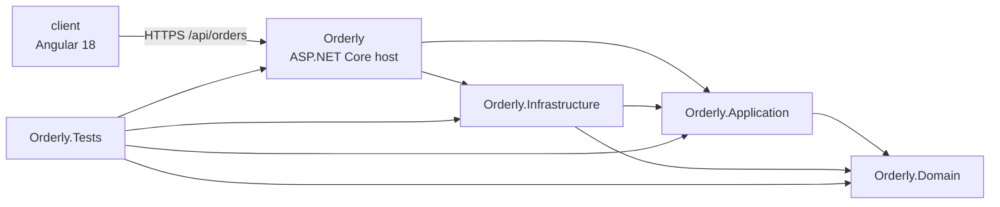
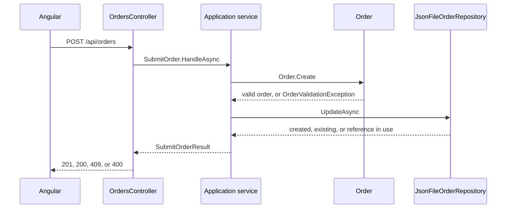

# Orderly solution

Orderly is a small purchase-order system. A user submits an order, sees the list newest first, opens one order to check server-calculated totals and status, and moves that status along a short sales flow. An Angular client talks to an ASP.NET Core API over HTTPS. The API stores orders in a local JSON file. There is no database, authentication, inventory, or payment flow.

## Shape of the solution

The .NET solution is `LexisNexis Tech Assessment.slnx`. Projects point inward: the host composes the application, the application depends on the domain, and the domain depends on nothing in the solution.

| Project | Responsibility |
| --- | --- |
| `Orderly.Domain` | Order, line, money, and status rules. Constructors reject invalid orders. No ASP.NET types and no file I/O. |
| `Orderly.Application` | Submit, get, list, and change status. Defines the repository and clock ports. Returns result objects the host can map to HTTP. |
| `Orderly.Infrastructure` | JSON file repository and the rule that the store path stays under the content root. |
| `Orderly` | Composition root, controller, request and response models, and HTTP error mapping. |
| `Orderly.Tests` | xUnit coverage of totals, validation, idempotent submit, listing order, status rules, the file store, and the HTTP pipeline. |
| `client` | Standalone Angular 18 screen: submit form, newest-first list, detail, status actions, and a local text filter. |

`Program.cs` is the only place that constructs `JsonFileOrderRepository`. Application services take `IOrderRepository` and `IClock`. Tests supply the real file repository pointed at a temp directory and a `FakeClock` so `CreatedAtUtc` is deterministic.

## Request path

A controller action calls one application method and maps the result. It does not calculate money or decide whether a status change is legal.

`SubmitOrderResult` and `ChangeOrderStatusResult` are closed records (`Created`, `Existing`, `ReferenceInUse`, `Invalid`, and the status equivalents). The controller switches on those cases. Domain types stay inside the application. The wire format is `OrderResponse`, built by `OrderResponseMapper` from the application read model `OrderDetails`.

## Domain

An order is created through `Order.Create` and loaded through `Order.Rehydrate`. Both paths run the same checks, so a stored document cannot come back as an order the domain would have refused.

`Order` holds a server-generated id, external reference, customer name, at least one line, a total, a status, and `CreatedAtUtc`. A new order starts as `Submitted`. `OrderLine` holds a description, a whole quantity of at least 1, a unit price of zero or more, and a line total.

Money lives in one place. `Money.Round` rounds to two decimal places with `MidpointRounding.AwayFromZero`. Each line total is `quantity * unitPrice`, rounded, and the order total is the rounded sum of those line totals. A client-sent total is never an input: the create DTO has no total fields, and the JSON serializer skips unmapped members.

Field limits are named constants on `OrderFieldLimits` (reference 64, customer name 200, description 200). The API DTOs reuse those constants through the application project, so the limits cannot drift between validation and the contract.

External references are reduced to letters and digits by `PurchaseOrderReference.Normalize`. `PO-1001` and `po 1001` are the same reference. The remaining characters are compared without case, so the digits still distinguish `PO-1001` from `PO-1002`. Customer names are trimmed and compared with an ordinal comparison. Two submissions are equivalent when that customer name matches and the line sequence matches after description trim and price rounding. Line order is part of the payload: swapping two lines is a different order.

Status changes go through `Order.TryChangeStatus`, which asks `OrderStatusPolicy`. One map of allowed transitions both decides the change and builds the rejection text:

- `Submitted` may become `Confirmed` or `Cancelled`.
- `Confirmed` may become `Fulfilled` or `Cancelled`.
- `Fulfilled` and `Cancelled` are terminal.

A rejected change names the current status and the statuses that are still allowed, and leaves the order as it was. Adding a status means editing that policy. The controller and the file repository stay the same.

## Application services

Each use case is a small type with one `HandleAsync` method.

- `SubmitOrder` builds a draft with the clock's UTC time. Inside a single repository update it looks up the normalized reference. A new reference is stored. An equivalent repeat returns the stored order, including its current status, and writes nothing. A different body for the same reference returns "The external reference is already used." and writes nothing. Validation failures return before the repository is asked to save.
- `GetOrder` loads one order by id.
- `ListOrders` loads the set and sorts by `CreatedAtUtc` descending, then `Id` descending. File order is irrelevant.
- `ChangeOrderStatus` parses the requested status with the domain policy, then updates the matching order in the same locked read-modify-write. An unknown status, a missing order, and an illegal transition each return a result and leave the file unchanged.

`IOrderRepository` exposes only get, list, and `UpdateAsync`. The update callback receives `IOrderCollection`, which can find by id, find by reference, add, or mark an in-memory change. The repository writes the file only when that collection reports changes, so a conflict or a rejected transition cannot persist a partial order.

`IClock` is the time port. `SystemClock` is registered in production. Tests set `FakeClock.UtcNow` when they need a known creation time.

## File storage

The path comes from configuration key `Storage:OrdersFile`, default `data/orders.json` under the API content root. `OrdersFileLocation.Resolve` expands that path and refuses anything that is not under the content root. A request cannot choose the file.

`JsonFileOrderRepository` holds a process-wide `SemaphoreSlim` and an exclusive `.lock` file across each read-modify-write, so two concurrent submits of the same reference cannot both insert. A missing or empty file means there are no orders. The directory is created when it is missing.

Writes go to a temp file in the same directory, flush to disk, then `File.Move` over the target. A crash during the write leaves the previous `orders.json` in place. If the move fails because another process still has the destination open, it retries a few times. A failed write deletes the temp file. On load, totals are recomputed by `Order.Rehydrate` from quantity and unit price, so a hand-edited total in the JSON does not become the order total.

The host does not serve `data/` as static files. The JSON file is readable by the API process.

## HTTP API

Base path: `/api/orders`.

| Action | Request | Success | Failure |
| --- | --- | --- | --- |
| Create | `POST /api/orders` | `201` and `Location` the first time | `400` `validation_error` |
| Equivalent repeat | same reference and same content | `200` and the stored order | |
| Different repeat | same reference, different content | | `409` `duplicate_reference` |
| Get one | `GET /api/orders/{id}` | `200` | `404` `order_not_found` |
| List | `GET /api/orders` | `200` array, newest first | |
| Change status | `PATCH /api/orders/{id}/status` with `{ "status": "Confirmed" }` | `200` and the updated order | `409` `invalid_status_transition`, or `404` if missing |

`POST` and `PATCH` require `application/json`. Bodies are capped at 64 KB. Invalid JSON and an unknown status value are `400` `validation_error`.

`OrderProblemMapper` is the only place that builds `ProblemDetails`. Every failure includes `title`, `status`, `detail`, and a `code` extension (`validation_error`, `duplicate_reference`, `order_not_found`, `invalid_status_transition`). The body omits exception type, stack trace, and file path. Logs record the order id and the failure code. Customer names, references, and prices stay out of the log.

OpenAPI is mapped in Development at `/openapi/v1.json`.

## Angular client

`client/` is Angular 18 with standalone components and `provideHttpClient`. There are no NgModules. `AppComponent` renders one screen, `OrdersComponent`.

`OrderService` owns every `/api/orders` call. `buildCreateOrderBody` is the only function that builds the create payload: trimmed reference, customer, and lines of description, quantity, and unit price. Totals are absent. The form posts that body to `https://localhost:7222` from `environment.apiUrl`. After `201` or an idempotent `200`, the screen refreshes the list and selects the returned order so the user can confirm line totals, the order total, and status. A `duplicate_reference` problem shows the API detail and selects the stored order when it is already in the list.

The list is rendered in the order the API returned. `filterOrders` narrows that list on the client by reference, customer, or status. `summarizeOrders` counts open, fulfilled, and cancelled orders and sums value from the server totals, excluding cancelled orders. Status buttons come from the same transition map as the server (`Submitted` to Confirmed or Cancelled, and so on). The server remains the authority: an illegal change displays the API `detail` and leaves the selected order unchanged.

Order text is bound with interpolation. The client does not use `bypassSecurityTrustHtml` or `innerHTML` for order data.

## Transport and hardening

The `https` launch profile listens on `https://localhost:7222` and `http://localhost:5170`. `UseHttpsRedirection` sends HTTP to HTTPS. HSTS is added when the environment is not Development. CORS allows only the origins in `Cors:Origins` (the Angular dev origin `http://localhost:4200`), with GET, POST, and PATCH. Credentials and wildcard origins are off. Responses set `X-Content-Type-Options: nosniff` and `Referrer-Policy: no-referrer`.

`appsettings.json` holds the orders file path and the CORS origin. It holds no secrets.

## Tests

`dotnet test "LexisNexis Tech Assessment.slnx"` runs the xUnit suite. Most tests call the application services through `OrderFixture`, which points `JsonFileOrderRepository` at a temp file. That covers:

- line and order totals, including half-away-from-zero rounding and a zero price
- rejected quantity, price, reference, customer, and line cases
- a first submit stored once as `Submitted` with server totals
- an equivalent resubmit returning the same id, and a different body leaving the stored order unchanged
- reference matching that ignores case and symbols, and line order that does not
- newest `CreatedAtUtc` first, with `Id` breaking ties
- each allowed status change, and each illegal one returning the policy message with the status unchanged
- a missing or empty file, a failed save that keeps the previous file, and a path outside the content root

`OrdersApiTests` and `SecurityApiTests` use the real pipeline where HTTP mapping itself matters: ignored client totals, problem codes, hidden stack traces and paths, HTTPS redirection, HSTS outside Development, CORS, and the response headers.

The client specs cover the create payload, the list filter, the status actions, and the summary counts.
